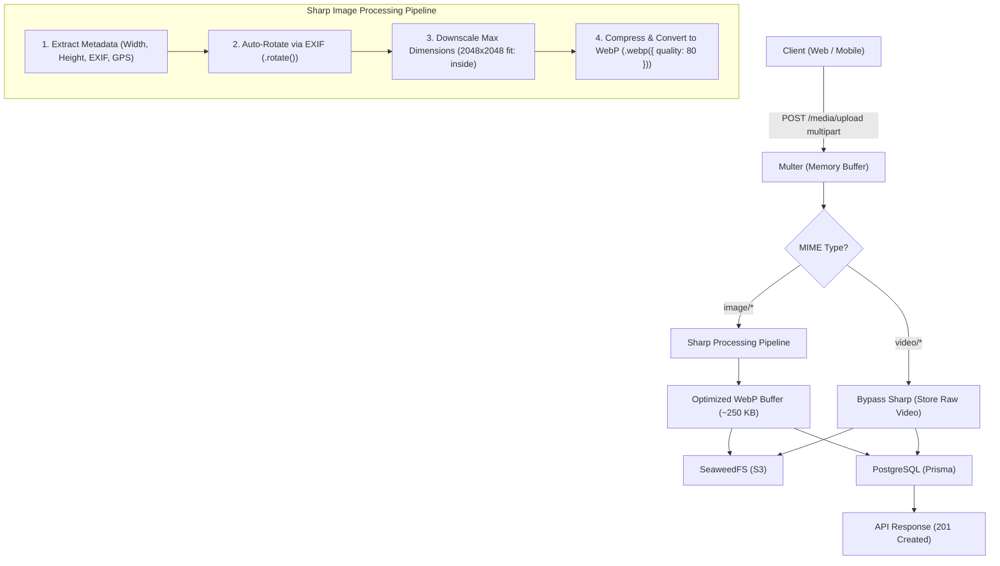

# Sharp Image Processing & Metadata Architecture Plan

## Executive Summary

This document specifies the technical design, architectural integration, and metadata handling strategy for incorporating **Sharp** (`sharp: ^0.35.5`) into the **EuroInspect** media pipeline.

Currently, uploaded images are passed directly from Multer's in-memory buffer to SeaweedFS (S3-compatible storage) as raw binaries. While functional, this leads to:
1. **Orientation bugs**: Photos taken on iOS/Android devices appear sideways or inverted in web browsers due to unhandled EXIF orientation flags.
2. **Bandwidth & storage bloat**: Modern smartphones capture 8–20 MB photos. Storing 20+ raw photos per vehicle inspection causes high storage costs and sluggish dashboard rendering.
3. **Missing database metadata**: The `Media` Prisma table contains `width` and `height` columns that currently remain `NULL`.

This plan details how Sharp transforms incoming raw photos into optimized **WebP** images, auto-corrects orientation, populates database dimensions, and strategically handles EXIF/GPS metadata.

---

## 1. High-Level Architecture & Workflow



---

## 2. The Metadata Strategy: What We Do with EXIF, GPS, & Orientation

In a vehicle inspection system, image metadata involves a critical trade-off between **audit compliance (proof of time & location)** vs. **privacy, security, and file size**.

### A. The Core Metadata Challenges
1. **EXIF Orientation**:
   * Mobile cameras don't physically rotate pixels; they write an orientation tag (numbers 1 through 8) into EXIF.
   * Browsers and `` tags inconsistently interpret this tag, resulting in photos appearing rotated by 90° or upside down.
2. **GPS Coordinates (Latitude / Longitude)**:
   * Representative photos often contain GPS location data.
   * Exposing raw EXIF to public or third-party viewers can leak private home addresses or inspector locations.
   * However, comparing photo GPS coordinates against the `InspectionRequest.latitude/longitude` is a powerful fraud-prevention tool.
3. **Capture Timestamp (`DateTimeOriginal`)**:
   * Verifies that the vehicle was photographed at the actual time of the inspection rather than using old photos.
4. **Metadata Bloat**:
   * Embedded camera maker notes, thumbnail caches, and XMP XML packets add 30 KB to 150 KB of non-image bloat per file.

---

### B. The Recommended "Extract-and-Strip" Strategy

We adopt the **Extract-and-Strip** design pattern:

```text
Raw Photo (with EXIF, GPS, MakerNotes)
                │
                ▼
   ┌──────────────────────────────────────────────┐
   │ 1. EXTRACT into Application Domain:          │
   │    • Width & Height (Post-rotation)          │
   │    • DateTimeOriginal (Capture Time)         │
   │    • GPS Latitude & Longitude                │
   │    • Device Make & Model (e.g., iPhone 15)   │
   └──────────────────────┬───────────────────────┘
                          │
                          ▼
   ┌──────────────────────────────────────────────┐
   │ 2. STRIP from Binary & Transform:            │
   │    • Auto-rotate pixel matrix to 0° normal   │
   │    • Strip all embedded EXIF/XMP tags        │
   │    • Convert to clean, compact WebP          │
   └──────────────────────┬───────────────────────┘
                          │
            ┌─────────────┴─────────────┐
            ▼                           ▼
   SeaweedFS (S3)              PostgreSQL (Prisma)
   Clean, fast WebP (~250KB)   Stores width, height,
   No sensitive GPS leakage.   and audit metadata safely.
```

#### Why Extract-and-Strip is Superior:
| Aspect | Keeping Raw EXIF in S3 (`.withMetadata()`) | Extract-and-Strip (Recommended) |
| :--- | :--- | :--- |
| **File Size** | Larger (+30KB to +100KB per photo) | Minimal (clean WebP) |
| **Privacy / Security** | Inspector device serials and home GPS exposed to anyone downloading image | Secured inside PostgreSQL; never leaked in image binary |
| **Auditability** | Difficult to query inside binary S3 blobs | Queryable directly in PostgreSQL database |
| **Orientation Safety** | Potential double-rotation bugs on older viewers | 100% bug-free; pixels physically normalized |

---

## 3. Image Optimization Specifications

| Parameter | Value | Justification |
| :--- | :--- | :--- |
| **Output Format** | **WebP** (`image/webp`) | 30%–80% smaller than JPEG with identical perceptual quality; supported by all modern browsers (Chrome, Safari, Firefox, Edge). |
| **Quality** | `80` | Sweet spot for automotive inspection (body scratches, VIN plates, and tire tread remain razor sharp). |
| **Max Dimensions** | `2048 x 2048` px | Fits 4K inspection displays without storing unnecessary 48MP smartphone sensor noise. |
| **Scaling Policy** | `withoutEnlargement: true`, `fit: 'inside'` | Small images are never upscaled (prevents pixelation); aspect ratio is strictly maintained. |
| **Auto-Orientation** | `.rotate()` | Corrects orientation using EXIF tag and resets the header orientation to 1. |
| **Color Space** | `sRGB` | Standardizes display colors across varying smartphone color profiles (P3, AdobeRGB). |
| **Compression Effort** | `effort: 4` (default) | Balances CPU compression time (~80ms) with output file size reduction. |

---

## 4. Video vs. Image Handling

Sharp is a native raster image processing engine. It **must not** receive video files.

* **Images** (`image/jpeg`, `image/png`, `image/webp`, `image/heic`, `image/heif`):
  * Processed through Sharp.
  * Extension changed to `.webp`.
  * MIME type updated to `image/webp`.
  * Dimensions populated.
* **Videos** (`video/mp4`, `video/quicktime`, `video/webm`):
  * Bypasses Sharp completely.
  * Uploaded directly to SeaweedFS with original buffer, original extension, and original MIME type.
  * Width, height, and duration can be set by client payload or left for future video-transcoder workers.

---

## 5. Clean Architecture Component Breakdown

Following the Domain-Driven Design (DDD) conventions of the project:

### 1. Domain Layer (`src/media/domain/`)
* **`interfaces/image-processor.service.interface.ts`**:
  ```typescript
  export interface ProcessedImageResult {
    buffer: Buffer;
    mimeType: string;
    extension: string;
    size: number;
    width: number;
    height: number;
    metadata?: {
      capturedAt?: Date;
      latitude?: number;
      longitude?: number;
      cameraMake?: string;
      cameraModel?: string;
    };
  }

  export interface IImageProcessorService {
    isSupportedImage(mimeType: string): boolean;
    process(fileBuffer: Buffer, originalMimeType: string): Promise<ProcessedImageResult>;
  }
  ```

### 2. Infrastructure Layer (`src/media/infrastructure/`)
* **`services/sharp-image-processor.service.ts`**:
  * Implements `IImageProcessorService`.
  * Executes the Sharp pipeline:
    ```typescript
    const image = sharp(fileBuffer);
    const rawMeta = await image.metadata();

    const processedBuffer = await image
      .rotate() // auto-orient based on EXIF
      .resize({
        width: 2048,
        height: 2048,
        fit: 'inside',
        withoutEnlargement: true,
      })
      .toColorspace('srgb')
      .webp({ quality: 80 })
      .toBuffer();

    const finalMeta = await sharp(processedBuffer).metadata();
    ```

### 3. Application Layer (`src/media/application/`)
* **`use-cases/upload-media.use-case.ts`**:
  * Injects `IImageProcessorService`.
  * If `isSupportedImage(file.mimetype)`:
    * Processes buffer through Sharp.
    * Uses new buffer for S3 upload.
    * Sets `objectKey` extension to `.webp`.
    * Sets `mimeType` to `image/webp`.
    * Sets `fileSize` to the compressed size.
    * Passes `width` and `height` to the `Media` entity.
  * If video:
    * Skips processing, uploads raw buffer.

### 4. Database Persistence Layer (`src/media/infrastructure/persistence/`)
* **`media.mapper.ts`**:
  * Maps `width` and `height` to Prisma `MediaCreateInput`.
  * Prisma already has `width Int?` and `height Int?` in the schema—**no database migration needed!**

---

## 6. S3 Key Naming with WebP Conversion

When an image is converted to WebP, its storage key reflects the new format:

```text
Before Sharp (Raw):
banks/{bankId}/inspections/{inspectionId}/{mediaId}.jpg   (Size: 8.4 MB)

After Sharp (Optimized):
banks/{bankId}/inspections/{inspectionId}/{mediaId}.webp  (Size: 240 KB)
```

For videos, the original extension remains untouched:
```text
banks/{bankId}/inspections/{inspectionId}/{mediaId}.mp4   (Size: 45 MB)
```

---

## 7. Error Handling & Resilience

1. **Corrupted or Truncated Images**:
   * If a user uploads a malformed file disguised with an image extension, Sharp throws an error (`Input buffer contains unsupported image format`).
   * The use case catches this and marks the `Media` record as `FAILED` with `failureReason: "Invalid or corrupted image format"`.
2. **HEIC / HEIF Mobile Formats**:
   * Sharp natively supports HEIC/HEIF on Node.js with libvips. They are cleanly converted to standard WebP.
3. **Memory Limits & Concurrency**:
   * Sharp utilizes libvips thread pools. Node.js memory remains bounded because images are streamed/processed one buffer at a time.
   * Upload limit in `FileInterceptor` remains 25 MB for images and 100 MB for videos.

---

## 8. Implementation Steps & Verification Plan

| Step | Action | Files Touched |
| :--- | :--- | :--- |
| **1** | Define `IImageProcessorService` contract and types | `src/media/domain/services/image-processor.service.interface.ts` |
| **2** | Implement `SharpImageProcessorService` with auto-rotate & WebP | `src/media/infrastructure/services/sharp-image-processor.service.ts` |
| **3** | Update `MediaModule` DI provider bindings | `src/media/media.module.ts` |
| **4** | Integrate processing into `UploadMediaUseCase` | `src/media/application/use-cases/upload-media.use-case.ts` |
| **5** | Pass `width` and `height` in `MediaMapper` and `Media` entity | `src/media/domain/entities/media.entity.ts`<br>`src/media/infrastructure/persistence/media.mapper.ts` |
| **6** | Write comprehensive unit tests for Sharp service and use case | `src/media/infrastructure/services/sharp-image-processor.service.spec.ts`<br>`src/media/application/use-cases/upload-media.use-case.spec.ts` |
| **7** | Run type check (`tsc`), linting (`eslint`), and test suite (`jest`) | Entire test suite |
| **8** | Rebuild Docker container to deploy changes | `docker compose up -d --build app` |

