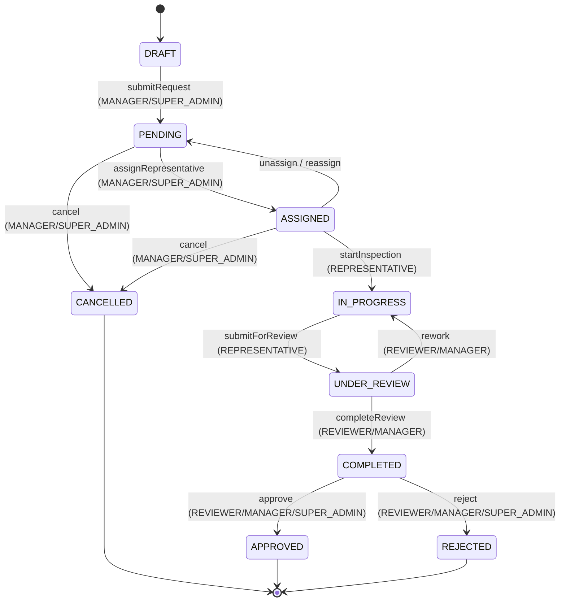

# Implementation Plan: Inspection Request Details & Workflow

> **Scope:** Backend only. No frontend. No unrelated module changes.

---

## 1. Findings from Codebase Inspection

### What Already Exists ✅

| Area | Status |
|---|---|
| `InspectionRequest` domain entity | ✅ Exists — `inspection-request.entity.ts` |
| `InspectionStatus` & `InspectionPriority` enums | ✅ Exist in `domain/value-objects/` |
| `IInspectionRequestRepository` interface | ✅ Exists, 4 methods |
| `PrismaInspectionRequestRepository` | ✅ Exists |
| `InspectionRequestMapper` | ✅ Exists (toDomain, toCreateData, toUpdateData) |
| `InspectionRequestService` | ✅ Exists — has `createRequest`, `submitRequest`, `getRequestById`, `listRequestsByBank` |
| `InspectionRequestController` | ✅ Exists — has `POST`, `POST /:id/submit`, `GET`, `GET /:id` |
| DB table `inspection_status_history` | ✅ Already migrated — `fromStatus?`, `toStatus`, `changedBy`, `changedAt` |
| DB table `inspection_assignments` | ✅ Already migrated — `representativeId`, `assignedBy`, `status`, `AssignmentStatus` enum |
| `JwtAuthGuard`, `RolesGuard`, `BankMembershipGuard` | ✅ Exist and fully work |
| `@Roles()`, `@CurrentUser()` decorators | ✅ Exist |
| `GlobalExceptionFilter` | ✅ Exists — handles Prisma errors, operational errors cleanly |
| `BaseException` pattern | ✅ Exists |
| `InspectionRequestNotFoundException` & other exceptions | ✅ Exist |
| `Role` enum | ✅ Exists — `SUPER_ADMIN, SYSTEM_ADMIN, MANAGER, REVIEWER, USER, VIEWER, REPRESENTATIVE` |
| `IUserRepository.findById()` | ✅ Exists |
| `UserService` (exported from IdentityModule) | ✅ Exists — has `getUserById()` |
| `BankService` + `BankMembershipGuard` | ✅ Handle bank isolation |

### What is Missing / Incomplete ❌

| Area | Gap |
|---|---|
| `GET /:id` response | Returns raw entity, no related data (vehicle, customer, checklist items, assignment, location) |
| Status history repository interface | ❌ Not implemented |
| Status history Prisma repository | ❌ Not implemented |
| Status history mapper | ❌ Not implemented |
| `GET /:requestId/status-history` endpoint | ❌ Not implemented |
| `PATCH /:requestId/status` endpoint | ❌ Not implemented |
| Status transition logic in domain entity | ❌ `InspectionRequest` only has `submit()`, no general `transition()` |
| Assignment repository interface | ❌ Not implemented |
| Assignment Prisma repository | ❌ Not implemented |
| Assignment mapper | ❌ Not implemented |
| `PUT /:requestId/assignment` endpoint | ❌ Not implemented |
| Assignment service logic | ❌ Not implemented |
| `note`/`reason` field on `InspectionStatusHistory` | ❌ DB column missing (schema has only `fromStatus`, `toStatus`, `changedBy`, `changedAt`) |
| Rich response DTO for `GET /:id` | ❌ Returns entity directly, needs a proper response DTO |
| `IInspectionRequestRepository.findById()` (without bankId scoping) | ❌ Missing — needed for SUPER_ADMIN / SYSTEM_ADMIN access |

### Business Decision: Status Transition Matrix

The existing code defines 9 statuses. No transition matrix exists in code. Based on the assignment and review workflow:



> **Note:** `ASSIGNED → PENDING` transition (reassignment/unassign) is handled implicitly by the assignment endpoint. `CANCELLED`, `APPROVED`, and `REJECTED` are terminal states.

---

## 2. Schema Change Required

The `inspection_status_history` table is missing a `note` column (optional reason/comment for status changes).

**Add to `prisma/models/inspection/status-history.prisma`:**
```prisma
note String?   // Optional reason or comment
```

**Migration:** `add_status_history_note`

---

## 3. Files to Create

### Domain Layer
| File | Purpose |
|---|---|
| `src/inspection/domain/entities/inspection-status-history.entity.ts` | Domain entity for status history records |
| `src/inspection/domain/entities/inspection-assignment.entity.ts` | Domain entity for assignment records |
| `src/inspection/domain/repositories/inspection-status-history.repository.interface.ts` | Repository interface for status history |
| `src/inspection/domain/repositories/inspection-assignment.repository.interface.ts` | Repository interface for assignments |

### Infrastructure Layer
| File | Purpose |
|---|---|
| `src/inspection/infrastructure/persistence/inspection-status-history.mapper.ts` | toDomain mapper |
| `src/inspection/infrastructure/persistence/inspection-assignment.mapper.ts` | toDomain mapper |
| `src/inspection/infrastructure/repositories/prisma-inspection-status-history.repository.ts` | save + findByRequestId |
| `src/inspection/infrastructure/repositories/prisma-inspection-assignment.repository.ts` | save + findActiveByRequestId + findById |

### Presentation Layer
| File | Purpose |
|---|---|
| `src/inspection/presentation/dto/inspection-request-detail.response.dto.ts` | Full response DTO for `GET /:id` |
| `src/inspection/presentation/dto/update-inspection-status.dto.ts` | `PATCH /status` input DTO |
| `src/inspection/presentation/dto/assign-representative.dto.ts` | `PUT /assignment` input DTO |
| `src/inspection/presentation/dto/inspection-status-history.response.dto.ts` | Response DTO for status history entries |

---

## 4. Files to Modify

| File | Change |
|---|---|
| `prisma/models/inspection/status-history.prisma` | Add `note String?` field |
| `src/inspection/domain/entities/inspection-request.entity.ts` | Add `transition()`, `assign()`, `unassign()` domain methods |
| `src/inspection/domain/repositories/inspection-request.repository.interface.ts` | Add `findById(id)` and `findByIdWithDetails()` method signatures |
| `src/inspection/infrastructure/repositories/prisma-inspection-request.repository.ts` | Implement `findById` and `findByIdWithDetails` with Prisma `include` |
| `src/inspection/infrastructure/persistence/inspection-request.mapper.ts` | Add `toUpdateData` fields for `assignedRepresentativeId`, `assignedAt` |
| `src/inspection/application/services/inspection-request.service.ts` | Add new use-case methods (`getRequestDetails`, `updateStatus`, `assignRepresentative`, `getStatusHistory`) |
| `src/inspection/presentation/controllers/inspection-request.controller.ts` | Add `PATCH /:id/status`, `PUT /:id/assignment`, `GET /:id/status-history`, update `GET /:id` |
| `src/inspection/inspection.module.ts` | Register new repositories as providers |
| `src/shared/exceptions/inspection.exceptions.ts` | Add `InvalidStatusTransitionException`, `InvalidAssignmentException`, `RepresentativeNotEligibleException` |

---

## 5. Endpoints to Implement

### 5.1 `GET /banks/:bankId/inspection-requests/:id` (enhance existing)
- **Roles:** `SUPER_ADMIN`, `SYSTEM_ADMIN`, `MANAGER`, `REVIEWER`, `REPRESENTATIVE` (assigned only).
- **Details included:** Request metadata, Customer details, Vehicle details, Location (Governorate & City), Active assignment (Representative details), Checklist items, Created/Updated timestamps.

### 5.2 `PATCH /banks/:bankId/inspection-requests/:id/status`
- **Roles:** `SUPER_ADMIN`, `SYSTEM_ADMIN`, `MANAGER`, `REVIEWER`, `REPRESENTATIVE`.
- **Logic:** Validates role-based status transition, updates request atomically, and writes to `inspection_status_history` with optional note.

### 5.3 `PUT /banks/:bankId/inspection-requests/:id/assignment`
- **Roles:** `SUPER_ADMIN`, `SYSTEM_ADMIN`, `MANAGER`.
- **Logic:** Validates request state (`PENDING` or `ASSIGNED`), validates representative role & bank membership, cancels prior assignment if reassigning, creates new assignment, updates request `assignedRepresentativeId`, transitions `PENDING → ASSIGNED`, and creates status history.

### 5.4 `GET /banks/:bankId/inspection-requests/:id/status-history`
- **Roles:** `SUPER_ADMIN`, `SYSTEM_ADMIN`, `MANAGER`, `REVIEWER`, `REPRESENTATIVE` (assigned only).
- **Returns:** Chronological array of status changes with user who changed it, fromStatus, toStatus, note, and changedAt.

---

## 6. Implementation Sequence

1. **Prisma Schema & Migration:** Add `note` to `status-history.prisma`, generate Prisma client.
2. **Domain Layer:** Add domain entities and repository interfaces (`InspectionStatusHistory`, `InspectionAssignment`), extend `InspectionRequest`.
3. **Exceptions:** Define specific domain/application exceptions.
4. **Infrastructure Layer:** Mappers, Prisma repositories, and register them in `InspectionModule`.
5. **Application Layer:** Implement workflow methods in `InspectionRequestService`.
6. **Presentation Layer:** Create DTOs and wire endpoints in `InspectionRequestController`.
7. **Verification:** TypeScript build, tests, and lint verification.
